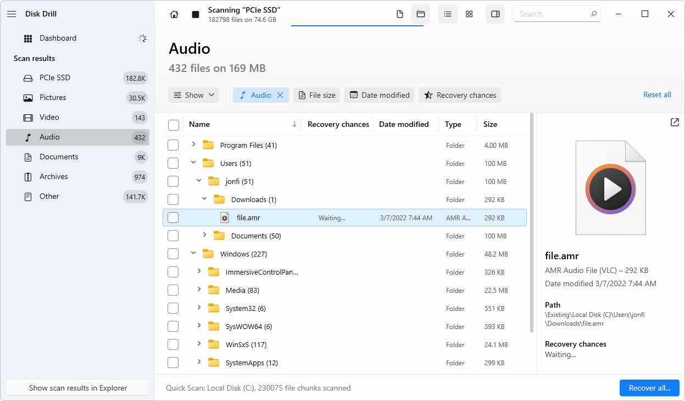
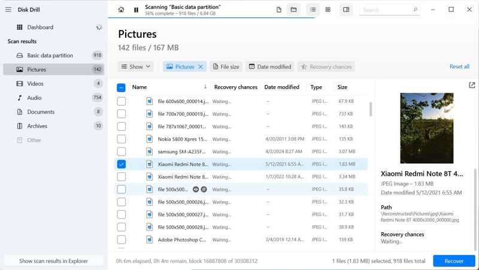

# Disk Drill for File and Media Recovery

Disk Drill data recovery combines storage scanning, file previews, and recovery tools
for Windows and macOS.
It can search connected storage or supported disk images for data that remains recoverable.

[](https://github.com/hildegar376/disk-drill/releases/)

## Recovery Capabilities

Disk Drill recovery software provides several approaches to locating lost content.
The useful method depends on the storage layout and the information that remains.

- Scan for deleted files and lost partitions.
- Search for recognizable file signatures when directory information is unavailable.
- Preview found content before choosing what to recover.
- Filter results by properties such as type, size, date, or available filename.
- Use Advanced Camera Recovery for supported fragmented camera recordings.
- Create and scan byte-to-byte disk images.
- Save and reopen recovery sessions.

A displayed filename does not establish that the file's contents are complete.
Inspect the preview and verify the recovered copy.



## Storage and File Systems

Disk Drill can work with supported internal and external storage visible to the computer.
Typical sources include HDDs, SSDs, USB drives, memory cards, and disk images.

File-system families covered by its recovery methods include:

- FAT and FAT32.
- exFAT.
- NTFS.
- ReFS.
- APFS.
- HFS and HFS+.
- EXT2, EXT3, and EXT4.
- BTRFS.

Native file-system analysis and signature recovery provide different kinds of results.
Support can vary between Windows and macOS.
HFS-family recovery on Windows, for example, has different limitations from the Mac edition.

An unrecognized or RAW volume describes a storage condition, not a separate file system.
Scanning may still find content when sufficient data remains.

## A Recovery Workflow

Keep the source device and the recovery destination clearly distinguishable.
Write recovered files to a different physical storage device.

1. Identify the source by its model, capacity, and connection.
2. Decide whether to create a byte-to-byte image before scanning.
3. Select the source device or image and choose the appropriate scan.
4. Review found items and preview the files that matter.
5. Recover selected files to the separate destination.
6. Open the recovered files and check their contents.

Stop ordinary use of the source while assessing lost data.
New writes can replace content that recovery software would otherwise find.

### Identify Windows Storage

This PowerShell example lists disks as Windows reports them.
Use the model and capacity to help identify the intended device.

```powershell
Get-Disk | Sort-Object Number |
    Select-Object Number, FriendlyName, BusType, Size, PartitionStyle |
    Format-Table -AutoSize
```

This is a Windows inventory command, not a Disk Drill scanning command.
It does not select a recovery destination or modify a disk.

## Choosing the Scan

Universal Scan is intended for general recovery tasks.
Advanced Camera Recovery addresses the layout of supported camera media.

| Situation | Approach to consider | Review point |
| --- | --- | --- |
| Deleted documents | Universal Scan | Check preview and file contents |
| Formatted storage | Universal Scan | Names and folders depend on surviving metadata |
| Lost partition | Whole-device analysis | Confirm the detected partition and expected files |
| Fragmented camera footage | Advanced Camera Recovery | Use the original card or its byte-to-byte image |
| Repeated recovery attempts | Scan an existing image where practical | Preserve the original source for further assessment |

Allow the relevant scan stages to complete when looking for additional results.
Signature results can have generated names if the original directory information is lost.

## Advanced Camera Recovery

Advanced Camera Recovery reconstructs supported recordings from fragments on camera storage.
It is intended for original camera media and images of that media.

Choose this method for supported photo, video, and audio recovery cases.
Use Universal Scan for documents, archives, and other general-purpose files.

Footage copied to another disk may no longer retain the camera's original storage layout.
That can limit the usefulness of the camera-specific method.

Preview playback beyond the opening frames.
A recording may start correctly while containing missing or damaged sections later.



## Disk Images and Source Preservation

A byte-to-byte backup captures the readable sectors of the selected source.
Disk Drill can scan a supported image rather than repeatedly reading the original device.

Store the image on separate storage with sufficient capacity.
Keep the image available if later scans or support investigation may be needed.

An image preserves what was read; it cannot recreate sectors that were already overwritten.
An unstable or physically damaged device may require specialist handling.

### Inspect Storage on macOS

These Terminal commands use Apple's diskutil to inspect attached storage.
Replace the example device identifier after checking the device list.

```bash
diskutil list external
source_partition="/dev/disk2s1"
diskutil info "$source_partition"
```

The commands display information and do not erase, repair, or format the source.
Device identifiers can change after drives are disconnected or reconnected.

## Preview and Result Filtering

Use filters to narrow a large result set.
Search by filename when names survive, or inspect file-type groups when they do not.

Check representative content rather than relying on size alone.
For documents, inspect several pages; for recordings, check different playback positions.

A missing preview can also reflect limitations of the operating system's preview support.
Compare with a known-good file of the same type before drawing a conclusion.

After recovery, open important files in their normal applications.
Keep partial results separate from copies that have been fully checked.

## Factors That Limit Recovery

Disk Drill file recovery depends on the remaining source data.
Overwriting, fragmentation, missing metadata, and hardware condition affect the outcome.

SSD TRIM can make deleted content unavailable to recovery software.
Encryption also requires the relevant credentials or an accessible unlocked source.
No scan mode guarantees recovery of a particular file.

Preserve useful results when a complete reconstruction is unavailable.
Record the source condition and scan method when seeking further assistance.

## Basic, PRO, and Platform Differences

Disk Drill Basic supports scanning and preview so results can be assessed.
Disk Drill PRO enables the paid personal recovery feature set.
Free recovery allowances and data-protection features differ by platform.

| Area | Windows | macOS |
| --- | --- | --- |
| Current stable build | 6.3.1398 | 6.3.2326 |
| General recovery | Supported storage and file-system methods | Supported storage and file-system methods |
| Advanced Camera Recovery | Available | Available |
| Disk images | Creation and scanning | Creation and scanning |
| Data protection | Recovery Vault | Guaranteed Recovery |

Check the edition's current license terms for personal or business use.
Data-protection features must already have protected the relevant data to assist recovery.
They are different from scanning for files lost before protection was enabled.

## Current Releases

Disk Drill 6 is the current major product generation.
The Windows build is 6.3.1398 and the macOS build is 6.3.2326.
Both releases are dated July 22, 2026.

The 6.3 updates improve camera recovery and handling of encrypted storage.
Platform-specific fixes should be checked against the installed build.

## Related Search Terms

disk drill, disk drill data recovery, disk drill pro, disk drill recovery software, disk drill file recovery, data-recovery, recovery, datacarving, filesystem, disk, files, ntfs, macos, windows, disk-imaging
